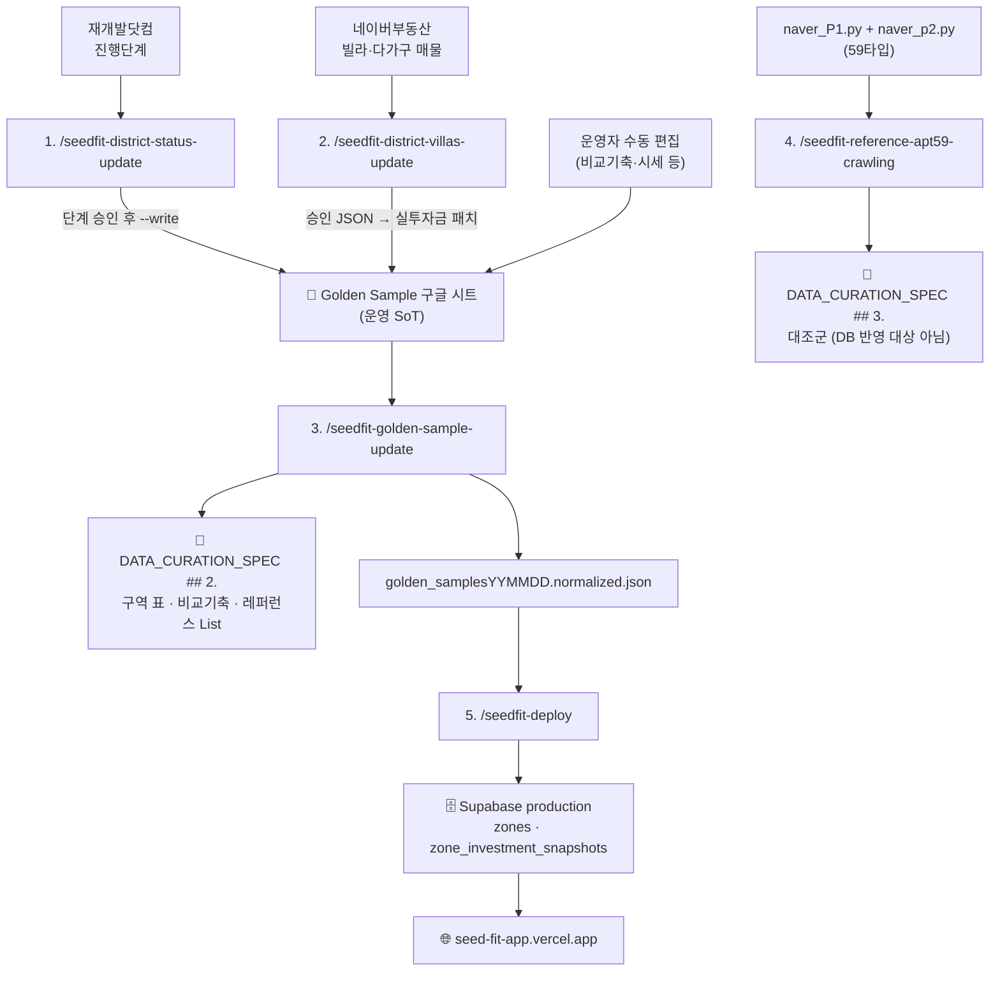

# 🛠 SeedFit 데이터 파이프라인 Skill 매뉴얼 (5종)

> **목적:** 재개발 구역 데이터가 **외부 원천 → Golden Sample 시트 → SoT 문서 → Supabase → Vercel Production**까지
> 흐르는 전 구간을 5개 Cursor Skill로 분할 소유하고, 각 스킬의 역할·입출력·절차·금지사항을 한 곳에 기술한다.
>
> **최종 갱신:** 2026-10-25 (장위14·15: 진행중 줄·모아 오매핑을 현재 단계에 쓰지 않음)
>
> ## 현재 운영 (2026-10-22)
>
> 아래 긴 본문에 `/seedfit-deploy`가 남아 있으면, 그 절차는 **`/seedfit-golden-sample-update` 7~12단계**다.
>
> | 언제 | 실행 |
> |---|---|
> | 시트에 없는 구역을 넣을 때 | `/seedfit-zone-add` (행·지도·폴리곤을 확인받은 뒤 매물 검수로 넘김) |
> | 매물 시세를 갱신할 때 | `/seedfit-district-villas-update` (끝나면 golden-sample-update를 호출) |
> | 사업 단계만 바꿀 때 | `/seedfit-district-status-update` 다음 `/seedfit-golden-sample-update` |
> | 비교 기축을 시트에서 고쳤을 때 | `/seedfit-golden-sample-update` |
> | 59타입 대조군만 | `/seedfit-reference-apt59-crawling` (배포 없음) |
>
> **관련 SoT:** `DATA_CURATION_SPEC.v.2.md` §6 (스킬 레지스트리 · 배포 합류 규칙)
> **블로그 스킬**(`/blog-redev`, `/blog-apt-price-update`)은 이 문서 범위 밖 → `SKILL_MANUAL_DATA_AND_BLOG260802.md`

---

## 0. 한눈에 보기

| # | Skill | 한 줄 역할 | 원천 | 종착점 | 사람 개입 |
| :---: | :--- | :--- | :--- | :--- | :---: |
| 1 | `/seedfit-district-status-update` | 구역 **진행단계**를 재개발닷컴에서 읽어 시트에 동기화 | 재개발닷컴 | Golden 시트 | **승인 필요** |
| 2 | `/seedfit-district-villas-update` | 구역 **빌라 매물**을 크롤 → 검수 → 실투자금 확정 → 배포 | 네이버부동산 | Production | **승인 필요** |
| 3 | `/seedfit-golden-sample-update` | 시트를 **SoT 문서 `## 2.`** 로 재생성 | Golden 시트 | 스펙 `## 2.` | 미리보기 확인 |
| 4 | `/seedfit-reference-apt59-crawling` | **59타입 대조군** 시세를 `## 3.` 에 반영 | Naver Land XLSX | 스펙 `## 3.` | **검수 필요** |
| 5 | `/seedfit-deploy` | 확정 데이터를 **Supabase → Vercel Production** 까지 배포 | normalized JSON | Production | 없음 |

### 0.1 전체 토폴로지



### 0.2 배포 합류 규칙 (2026-09-28 신설)

**앱 DB(`zones`·`zone_investment_snapshots`)를 바꾸는 스킬은 전부 `/seedfit-deploy`로 합류한다.**

이전에는 `/seedfit-district-villas-update` 만 Production에 도달해서,
**진행단계만 바뀌고 신규 매물이 없는 달의 변경분이 배포되지 않는 구멍**이 있었다.

| 스킬 | deploy 합류 | 이유 |
| :--- | :---: | :--- |
| 1. status-update | ✅ (핸드오프) | `현재 단계`·`coverage`가 스캐터 X축·CORE/SUB 필터를 직접 바꾼다 |
| 2. villas-update | ✅ (8번 항목으로 **자체 호출**) | 실투자금이 매칭 로직의 키다. 중복 실행하지 않는다 |
| 3. golden-sample-update | ✅ (핸드오프) | 스펙만 고치면 앱은 그대로다 |
| 4. apt59-crawling | ❌ | `## 3.` 대조군은 아직 DB 반영 대상이 아니다 (MVP-031) → 문서 커밋까지가 끝 |
| 5. deploy | — | 합류 지점 자신 |

**배포 구간 절차·스크립트의 소유권은 `/seedfit-deploy` 단독이다.** 다른 스킬에 복제하지 않는다.

---

## 1. 공통 규약

### 1.1 실행 환경

```powershell
$env:PYTHONUTF8="1"          # 항상
$env:PYTHONUNBUFFERED="1"    # 장시간 배치(크롤)일 때 추가
cd SeedFit_app_mvp            # 파이썬 스크립트 기본 작업 디렉터리
```

배포 구간(`/seedfit-deploy` 2·3·5단계)만 `SeedFit_app_mvp/frontend` 로 이동한다.

### 1.2 사람 개입 게이트 3곳 (에이전트가 대신 통과할 수 없음)

| 게이트 | 스킬 | 무엇을 승인하나 | 없으면 |
| :--- | :--- | :--- | :--- |
| **단계 승인** | 1. status-update | `stageDiff=changed` 구역별 단계 변경 | `--apply-stage-changes` 금지, `stagePendingApproval` 로 보류 |
| **매물 승인** | 2. villas-update | 검수 보드의 매물 5건 (`승인=Y`) | 국면 A에서 정지. Golden·스펙·배포로 가지 않음 |
| **엑셀 검수** | 4. apt59-crawling | XLSX 2개의 `매물없음` 과다·이상치 | Stage 2 진입 금지 |

### 1.3 SoT 소유권 매트릭스

| 대상 | 소유 스킬 | 비고 |
| :--- | :--- | :--- |
| 시트 `현재 단계`(D) · `coverage`(E) · `jaegebal_url`(F) · `진행현황` | 1. status-update | 승인 후에만 D·E |
| 시트 `최소·최대 실투자금`(C) · `매매가`(G) · 프리미엄 | 2. villas-update | **승인된 구역 통합본 범위만** |
| 시트 `비교 기축 아파트` · `기축 아파트 시세` | 운영자 수동 (VLOOKUP O·P열) | 3번이 읽어서 문서화 |
| 스펙 `## 2.` 구역 표 + 비교기축 열 + `🏢 레퍼런스 단지 List` | 3. golden-sample-update | 84타입 |
| 스펙 `## 3.` 대조군 (3.1/3.2) | 4. apt59-crawling | 59타입. **84타입 건드리지 않음** |
| `data/seed/seed_mvp_data.sql` · Supabase · Vercel | 5. deploy | 단독 소유 |

### 1.4 절대 금지 (전 스킬 공통)

- **크롤 호가를 실투자금·매매가로 자동 기입** — 중개사 표기 오류·구역 혼입이 잦다. 반드시 사람 검수 통과분만.
- **사람 승인 게이트를 에이전트가 대신 승인**
- 비밀번호·연결 문자열(`.env.supabase-prod`)을 채팅·커밋에 노출
- 검수 리포트 없이 `--write`

---

## 2. `/seedfit-district-status-update` — 재개발닷컴 → Golden 시트

### 2.1 역할 (상세)

재개발닷컴(`https://jaegebal.com/develops/{id}`)의 구역 페이지를 Playwright로 읽어,
**사업 진행단계**와 **진행현황 타임라인**을 Golden Sample 구글 시트에 써넣는다.

이 스킬이 갱신하는 `현재 단계`는 단순한 라벨이 아니다 —
스캐터 차트의 **X축 좌표(1~8단계)** 와 **`coverage`(CORE/SUB) 파생**을 동시에 결정하므로,
잘못 쓰면 구역이 차트에서 통째로 사라지거나 역필터 대상에서 빠진다.

API 응답이 암호화되어 있어 **DOM을 직접 읽는다.**

| 읽는 곳 | DOM 셀렉터 | 쓰는 곳 |
| :--- | :--- | :--- |
| 상단 빨간박스 (메타 단계) | `.develop-meta-item--stage` | 시트 `현재 단계` (D열) |
| 진행현황 탭 타임라인 | `.progress-steps` | 시트 `진행현황` 열 |
| — (파생) | `derive_coverage` | 시트 `coverage` (E열) |
| override → 시트 → 구역명 검색 | — | 시트 `jaegebal_url` (F열) |

### 2.2 INPUT / OUTPUT

| 구분 | 내용 |
| :--- | :--- |
| **INPUT** | 최신 Golden CSV (`docs/golden_samples….csv.csv`) — **CORE·SUB 전 행**. coverage로 거르지 않는다 |
| | `data/reference/jaegebal_zone_overrides.json` — 오매칭 구역 강제 URL (14건 등록) |
| | `data/reference/jaegebal_stage_map.json` — 사이트 라벨 → 시트 라벨 매핑 (신통/모아 kind 분기) |
| **OUTPUT** | `data/reports/jaegebal_district_status_YYMMDD.json` (+ `.md`) — 단계 diff 리포트 |
| | Golden 시트 D·E·F 열 + `진행현황` 열 (Drive xlsx round-trip) |
| **DoD** | 시트 `--write` 반영까지. **fetch·리포트만 만들고 멈추면 미완료** |

### 2.3 절차

```
[ ] 1.  입력 CSV 준비 (CORE+SUB 전 행, jaegebal_url·overrides 가능하면 채움)
[ ] 2.  fetch → 리포트 검수 (changed / blocked / error / 오매칭)
[ ] 2b. stageDiff=changed 목록을 사용자에게 제시하고 ★구역별 승인★
[ ] 3.  apply --write           → 진행현황·URL 만 (단계는 아직 안 씀)
[ ] 3b. apply --write --apply-stage-changes  → 승인된 단계만
[ ] 3c. promotedToCore 있으면 → /seedfit-district-villas-update --zone-keys …
[ ] 4.  (핸드오프) /seedfit-golden-sample-update → 스펙 ## 2.
[ ] 5.  (핸드오프) /seedfit-deploy → Supabase → Production
```

**배치 fetch**

```powershell
$env:PYTHONUTF8="1"; $env:PYTHONUNBUFFERED="1"
cd SeedFit_app_mvp

python -u scripts/data/fetch_jaegebal_district_status.py `
  --input docs/golden_samples….csv.csv `
  --output data/reports/jaegebal_district_status_YYMMDD.json `
  --delay-ms 800
```

**반영 (3단계 → 3b단계 순서 엄수)**

```powershell
# 미리보기
python scripts/data/apply_jaegebal_district_status.py --diff data/reports/jaegebal_district_status_….json

# 진행현황·URL 만
python scripts/data/apply_jaegebal_district_status.py --diff … --write

# 사용자가 단계를 승인한 뒤에만
python scripts/data/apply_jaegebal_district_status.py --diff … --write --apply-stage-changes
```

### 2.4 핵심 판정 규칙

- **`현재 단계` = 완료된 마지막 마일스톤.** 다음 단계가 진행 중이어도(예: 사업시행인가 진행중)
  이미 완료된 시공사 선정을 덮어쓰지 않는다. 진행현황의 "진행중"으로 D열을 갈아끼우지 않는다.
  apply는 후보 단계가 진행현황에서 `진행중`이면 skip (`skippedInProgressStage`).
  (실제 사고: 장위14 `사업시행인가|196개월째 진행중` → 시공사 선정으로 되돌림. 2010.07.11은 시공사 선정일이지 건축심의·사업시행인가가 아님)
- **비모아 구역에 `(모아)*` 단계가 붙으면 stage 갱신 skip.**
  (실제 사고·재발: 장위15 일반 재개발 통합심의 → `(모아)통합심의통과` → SUB. 2026-10-25에 시공사 선정·CORE로 복구)
- 구역명에 `모아`가 없으면 projectKind를 moa로 두지 않는다. `통합심의통과` common = `건축심의`.
- **모아 CORE 컷:** `(모아)관리계획고시` **이상**만 CORE. `통합심의통과`·`관리계획수립`은 SUB.
- **추진위 CORE 컷:** `추진위 승인`·`추진위설립`은 지정 전에도 있다. 진행현황에 `정비구역지정` 또는 `(모아)관리계획고시`가 날짜로 완료된 곳만 CORE. `진행중`은 SUB. 연번·대상지는 옛 지정 날짜가 있어도 SUB.
- 시트명 vs 사이트 표기 불일치(자양1동 779↔799, 593 1동↔2동)는 override note 확인,
  불확실하면 **단계 skip · URL/진행현황만** 반영.

### 2.5 진행현황 셀 포맷

```
대상지선정|2024.10.21
기획완료|2025.8.6
추진위승인|2026.1.7
정비구역지정|2026.1.22
조합설립인가|6개월째 진행중(평균 14개월)
```

기존 라벨 유지 · 없는 라벨만 append · 같은 라벨의 detail 변경 시 갱신 · **detail 없는 미래 단계는 저장 안 함**.

### 2.6 업데이트 음영

**실제로 값이 바뀐** D~M 셀만 호박색(`#FFF2CC`). `진행현황` 열은 D~M 밖이라 음영 대상 아님.

### 2.7 금지

- fetch만 하고 시트 `--write` 생략한 채 완료 선언
- 상단 메타 대신 진행현황 "진행중"으로 D열 교체
- 매핑 실패(`blocked`) 단계를 창작 반영
- 사용자 승인 없이 `--apply-stage-changes`
- CORE만 돌리고 SUB 제외
- 비모아에 `(모아)*` 덮어쓰기
- SUB→CORE 승격 후 villas-update 생략한 채 Production 부분 반영

### 2.8 관련

`scripts/data/fetch_jaegebal_district_status.py` · `apply_jaegebal_district_status.py` · `jaegebal_stage_lib.py`
`data/reference/jaegebal_stage_map.json` · `jaegebal_zone_overrides.json`

> ⚠️ `--write` 는 **Drive xlsx round-trip** 이다. 본표 수식·피벗을 통째로 건드리므로 검수 없이 실행 금지.

---

## 3. `/seedfit-district-villas-update` — 빌라 매물 → 검수 → Golden → 배포

### 3.1 역할 (상세)

재개발 구역의 **빌라·다가구 매물**을 네이버부동산에서 크롤해, 구역별 **실투자금(초투) 범위**를 갱신한다.
5개 스킬 중 유일하게 **원천 크롤부터 Production 배포까지 전 구간**을 관장한다.

재개발 매물은 아파트와 달리 `complexNo`가 없어 단지 단위 조회가 불가능하다.
따라서 **정부 구역계 폴리곤 ∩ 법정동 전수 크롤 → point-in-polygon(PIP)** 으로 소속을 판정한다.

**이 스킬의 존재 이유는 "크롤 값을 그대로 믿으면 안 되기 때문"이다.**
네이버 매물 설명의 초투/실투자금 표기는 중개사마다 다르고 오류가 잦아,
반드시 **사람이 HTML 검수 보드에서 승인한 값만** Golden에 들어간다.

### 3.2 국면 구조 (A / B)

| 국면 | 사용자 입력 | DoD |
| :--- | :--- | :--- |
| **A. 검수 보드** | `/seedfit-district-villas-update` | `data/reports/listing_review_YYMMDD.html` 생성 + **`file://` 전체 경로 안내**. **여기서 정지** |
| **B. 승인 반영~배포** | 승인 JSON/CSV 전달 | Golden 실투자금 패치 + 스펙 `## 2.` + 아카이브 3종 + `/seedfit-deploy`. Production URL 확인 |

보드 제목 고정: `매물 검수 보드 — YYYY-MM-DD`

### 3.3 파이프라인

```
폴리곤 ∩ 법정동 전수 → PIP → 소속 필터 → 상세 보강 → listing_review_YYMMDD.html
  → (사람) 보드 승인 JSON 내보내기
  → apply --write (실투자금 min/max)
  → zone_rollup html/xlsx (현재 단계 + 초투/매매 min/max, 초투min 정렬)
  → archive/golden 루트 + YYMMDD/
  → /seedfit-golden-sample-update 절차로 스펙 ## 2.
  → /seedfit-deploy (Supabase → git → Vercel Production)
  → blog HTML (승인 CORE만. SUB·CORE 보류 제외. 6개 예산 × 구역·단계·초투)
```

### 3.4 절차 체크리스트

```
국면 A
[ ] 1.  입력 SoT: 최신 golden CSV/normalized + polygons + geo
[ ] 1b. 관리처분인가+ 이고 빌라 PIP 안=0이면 fetch_jgb_listing_fallback.py
[ ] 2.  fetch_zone_listing_candidates.py (PIP + session-playwright + enrich)
[ ] 2b. diagnose_zone_polygon_listings.py  (폴리곤 오매칭 상시 감사)
[ ] 3.  render_listing_review_html.py → file:/// 안내 후 ★정지★

국면 B (승인 JSON 받은 뒤)
[ ] 4.  apply_approved_listing_investments.py  dry-run → 확인 후 --write
[ ] 5.  render_zone_rollup_table.py (단계열·min/max·초투min 정렬)
[ ] 6.  archive/golden 루트 + YYMMDD/ 에 html, xlsx, golden_samples.xlsx
[ ] 7.  fetch_golden_samples_from_drive → normalize → validate → render_zone_master_md --write
[ ] 8.  /seedfit-deploy (seed → Supabase → 카운트 검증 → git push → vercel --prod → 스모크)
[ ] 9.  render_blog_invest_tables.py — 검수보드 승인 ∩ CORE. SUB·CORE 보류 제외. 6개 예산 표
```

### 3.5 크롤 규칙 (국면 A)

- **소속 판정 주축 = 폴리곤 PIP.**
- **소속 필터** (`listing_zone_filters.py`, 전부 기본 ON) — 헤드라인(제목·매물특징)만 읽는다:

| 규칙 | 내용 |
| :--- | :--- |
| 좌표 미공개 | **구역명을 말할 때만** 통과 (JGB 채널은 면제 — 구역 ID가 소속 증거) |
| 다른 구역 명시 | 헤드라인에 타 구역명이 있으면 제외 |
| 구역외 자백 | `신흥동구역외`·`재개발 제외` 문구는 폴리곤보다 정확 |
| 같은 이름 다른 사업 | `소규모재개발`·`가로주택`·`지구단위`는 제외 (Golden 자체가 모아타운이면 미적용) |
| 근생 제외 | `상가`·`근린생활시설`·`토지` 제외. **단 `상가주택`은 주거로 본다** (조합원 물건) |

- **보드 = 예상 초투 낮은 5건.** 정렬은 `예상초투 → 호가` **뿐**이고, 동가일 때만 좌표 확인분이 앞선다.
  (자격 신호를 정렬 키로 얹으면 최저가가 밀린다 — 실제 사고: 신길2 8.5억·방배15 25억 누락)
- 기본 매물 유형: `VL:DDDGG:JWJT:SGJT:HOJT`
- `--overlap-cortars` 기본 ON
- 경기 임시 폴리곤: `--provisional-buffer-m 20` + `--require-zone-mention`.
  **시드 지번은 고시·보도로 교차검증** (실제 사고: 신흥1↔신흥3 폴리곤 뒤바뀜)
- 관리처분인가 이후라도 **빌라 PIP가 기본.** 좌표 안=0이면 JGB `redevelopmentAreaNo` 병행
- **429면 즉시 재시도 금지**

### 3.6 롤업 + 아카이브 (4장)

```powershell
python scripts/data/render_zone_rollup_table.py `
  --input data/reports/구역_통합본_YYMMDD.csv `
  --stamp YYMMDD `
  --golden-csv docs/golden_samplesYYMMDD.csv.csv
```

**저장 위치 (`data/archive/golden/`)** — 루트는 최신 덮어쓰기, 일자 폴더는 스냅샷 보존:

| 최신 (루트) | 일자 폴더 |
| :--- | :--- |
| `zone_rollup.html` | `YYMMDD/zone_rollup_YYMMDD.html` |
| `zone_rollup.xlsx` | `YYMMDD/zone_rollup_YYMMDD.xlsx` |
| `golden_samples.xlsx` | `YYMMDD/golden_samples_YYMMDD.xlsx` |

**롤업 열 구조** (HTML·xlsx 동일):

```
구 | 동 | 구역 | 현재 단계 | 표본 | 초투min | 초투max | 매매min | 매매max | Pmin | Pmax | …
                  ↑ C열(구역) 바로 뒤        ↑ 범위 문자열이 아닌 float 숫자
```

- **정렬 키 = 초투min 오름차순.** xlsx가 숫자라 엑셀에서도 그대로 정렬된다.
- ASCII 파일명이라 탐색기 더블클릭으로 브라우저에서 열린다.
- 일자 폴더는 **다음 달 증감 비교용**이다. SoT는 계속 구글 시트이고 이 폴더는 스냅샷이다.

### 3.7 Golden 반영 규칙 (3장)

| 롤업 열 | → Golden |
| :--- | :--- |
| `예상초투_min/max(억)` | `최소·최대 실투자금` |
| `매매가_min/max(억)` | `매매가` (G열) |
| `P_min/max(억)` | `최소·최대 프리미엄` (힌트 있을 때만) |

- 반영은 **실투자금**이 본선. `--write` 는 사이드카 패치이며 본표 VLOOKUP 열을 xlsx 통파일로 덮지 않는다.
- **±20% 이탈은 기본 차단** (`호가_이상플래그` HIGH/LOW → 승인 보류)
- 1차 승인 기본값은 **보드 5건 전부 포함**. 제외는 매물 미승인으로만.
- 표본 0건 구역은 기존 Golden 값 유지.

### 3.8 SUB→CORE 승격 진입

`/seedfit-district-status-update`가 coverage를 SUB→CORE로 올린 구역은
**그 구역 `--zone-keys` 만으로** 이 스킬을 바로 이어서 돌린다.
CORE만 크롤하는 관례가 있어도 **방금 CORE가 된 구역은 빼지 않는다.**

### 3.9 금지

- 검수 보드 없이 크롤 JSON을 Golden에 넣기
- 호가/힌트를 실투자금·매매가로 자동 복사
- 폴리곤 없는 구역을 동 전수 결과로 귀속
- 429 직후 재요청
- 승인 게이트를 에이전트가 대신 승인
- 승인 JSON 없이 스펙 재생성·Supabase·Production 배포

### 3.10 관련

`fetch_zone_listing_candidates.py` · `render_listing_review_html.py` · `apply_approved_listing_investments.py`
`render_zone_rollup_table.py`(`copy_rollup_artifacts`) · `listing_zone_filters.py` · `listing_detail_parse.py`
`diagnose_zone_polygon_listings.py` · `fetch_jgb_listing_fallback.py`

런북: `docs/ZONE_LISTING_CRAWL_RUNBOOK.md` · `.cursor/rules/009-zone-listing-crawl-rules.mdc`

---

## 4. `/seedfit-golden-sample-update` — Golden 시트 → 스펙 SoT

### 4.1 역할 (상세)

운영자가 구글 시트에서 손으로 큐레이션한 결과(구역 정보 · 비교 기축 단지 시세)를
**SoT 문서 `DATA_CURATION_SPEC.v.2.md`** 로 옮겨 앱이 읽을 수 있는 형태로 만든다.

인증된 `rclone`으로 시트를 CSV export 하므로 **수동 다운로드/업로드가 없다.**

이 스킬은 스펙의 다음 3곳을 **함께** 소유한다 (따로 갱신하면 불일치가 생긴다):

1. `## 2.` 행정구별 구역 표
2. 그 안의 `비교 기축 아파트 (84타입 기준)` 열
3. `### 🏢 레퍼런스 단지 List`

> 59타입 Naver Land 세트(`/seedfit-reference-apt59-crawling`)로는 이 3곳을 **절대 갱신하지 않는다.**

원본 시트 ID: `1YaZjGX53HGNQyAjLp0AIQFGq-j0IWcfPl5WFgUeUfuY`
구 이름: `/redevelopment` (동일 절차)

### 4.2 INPUT / OUTPUT

| 구분 | 내용 |
| :--- | :--- |
| **INPUT** | Google 시트 (rclone `gdrive:` remote 인증 필요, 최초 1회) |
| **중간** | `docs/golden_samples{YYMMDD}.csv.csv` → `data/normalized/golden_samples{YYMMDD}.normalized.json` |
| **OUTPUT** | 스펙 `## 2.` 구역 표 + 비교기축 열 + 레퍼런스 List |
| | **normalized JSON** — `/seedfit-deploy` 의 입력이 된다 |

### 4.3 절차

```
[ ] 0. rclone gdrive remote 확인
[ ] 1. 구글 시트 → docs CSV 자동 export
[ ] 2. 사용할 CSV 파일명 확인
[ ] 3. 정규화(normalize) + warning 확인
[ ] 4. 품질 검증(validate) + error 확인
[ ] 5. section 2 + 레퍼런스 List 미리보기 + 사용자 확인
[ ] 6. 반영(--write)
[ ] 7. /seedfit-deploy 로 Production 반영 (핸드오프)
```

```bash
# 1
python scripts/data/fetch_golden_samples_from_drive.py

# 3
python scripts/data/normalize_golden_samples.py --input docs/<csv> --output data/normalized/golden_samples<YYMMDD>.normalized.json

# 4
python scripts/data/validate_mvp_data_quality.py --golden data/normalized/golden_samples<YYMMDD>.normalized.json

# 5 미리보기
python scripts/data/render_zone_master_md.py --golden … --spec docs/DATA_CURATION_SPEC.v.2.md --out data/reports/section2_preview.md

# 6 반영
python scripts/data/render_zone_master_md.py --golden … --spec docs/DATA_CURATION_SPEC.v.2.md --write
```

확인 후 `data/reports/section2_preview.md` 삭제.

### 4.4 중단 조건

3단계 정규화에서 아래가 나오면 **시트 원본을 고친 뒤 1단계부터 다시** 한다:

`unknown_stage` · `money_parse_error` · `duplicate_zone` · `investment_range_inverted` · `ambiguous_reference_price`

4단계에서 `reference_link_count_mismatch` / `seed_count_mismatch` 만 있고
이번 작업에서 seed SQL을 돌리지 않으면 문서 반영은 진행 가능(요약 후 진행).

### 4.5 주의 — VLOOKUP 열

시트 보조탭 `시트1`(행정동→비교기축단지) · `단지별시세`(단지→시세)를 쓰는
**O열 = `VLOOKUP(B{행},시트1)`, P열 = `VLOOKUP(O{행},단지별시세)`** 는 **같은 행**을 가리켜야 한다.
정렬 후 행번호가 어긋나면 오매칭된다. 복구: `scripts/data/repair_ref_vlookup_and_map_tab.py`

> 🚩 **신규 열을 추가할 때는 반드시 P열 이후(Q~)에 넣는다.** 중간 삽입 시 VLOOKUP이 전부 깨진다.

### 4.6 Fallback

rclone/시트 export 실패 시 사용자가 CSV를 `docs/`에 직접 넣고 **2단계부터** 진행.

### 4.7 중복 실행 방지

`/seedfit-district-villas-update` 국면 B가 이 스킬의 절차를 **인라인으로 호출**한다.
그 경로로 들어온 경우 배포는 villas-update가 8번 항목으로 수행하므로 **7단계를 중복 실행하지 않는다.**

---

## 5. `/seedfit-reference-apt59-crawling` — 59타입 대조군 → 스펙 `## 3.`

### 5.1 역할 (상세)

**"같은 돈으로 살 수 있는 기축 아파트"** 비교군의 시세를 갱신한다.
재개발 구역 투자와 기축 매수의 **기회비용**을 보여주는 교육용 데이터다.

`naver_P1.py` / `naver_p2.py` 로 59타입 단지 시세를 크롤해
스펙 `## 3. 대조군 기축 아파트 데이터`(3.1 LTV 70% / 3.2 LTV 40% 모델)를 재계산한다.

구 이름: `/reference`

### 5.2 타입 구분 (가장 중요 — 혼동 사고 방지)

| 대상 | 타입 | 소유 스킬 |
| :--- | :---: | :--- |
| `## 3.` 대조군 기축 아파트 | **59타입** | ✅ 이 스킬 |
| `### 🏢 레퍼런스 단지 List` | 84타입 | ❌ golden-sample-update |
| `## 2.` 의 `비교 기축 아파트` 열 | 84타입 | ❌ golden-sample-update |

**이 59타입 세트로 84타입 항목을 갱신하지 않는다.**

### 5.3 2단계 구조

```
Stage 1 (크롤 + 사람 검수)
[ ] 1. 크롤러 의존성 확인   python -c "import httpx, openpyxl, playwright"
[ ] 2. naver_P1.py / naver_p2.py 실행 → Naver_Land_{MMDD}_{HHMM}.xlsx 2개
[ ] 3. 결과 XLSX 2개를 docs/ 로 이동
[ ] 4. ★사용자 엑셀 검수 요청 → 여기서 정지★

Stage 2 (검수 통과 후)
[ ] 5. 파일 세트 계약 갱신 (normalizer REQUIRED_SOURCE_FILES + 문서 2곳)
[ ] 6. normalize 실행 + warning 확인
[ ] 7. MVP_COMPARISON_ASSETS_PIPELINE260627.md 메타데이터 갱신
[ ] 8. section 3 (3.1/3.2) 재계산 반영
[ ] (하지 않음) 레퍼런스 List / section 2 84타입 기축 열
```

### 5.4 파일 세트 계약

**Naver Land XLSX는 항상 2개를 하나의 세트로 교체한다.** 새 세트 반영 시 3곳을 함께 갱신:

1. `scripts/data/normalize_naver_land.py` 의 `REQUIRED_SOURCE_FILES`
2. `docs/MVP_COMPARISON_ASSETS_PIPELINE260627.md` (파일명·기준일·수집 시각·큐레이터)
3. `docs/DATA_CURATION_SPEC.v.2.md` NAVER LAND 원칙 블록의 두 파일명

### 5.5 기준가 산정 규칙

- `매물없음` 제외 → **`저층` 제외 `중고층` 이상 최저가**를 우선 후보
- 중고층 이상이 없으면 저층 최저가를 fallback으로 쓰되 **저층 기준가임을 표시**
- `매물없음`은 오류가 아니라 "현재 호가 없음" 상태로 관리
- 매칭 안 된 단지는 **기존 최저가 유지 + warning**

### 5.6 대출 산식 (스펙 §3 SoT)

```
대출 Max:  15억 이하 → 6억 | 15억 초과 25억 이하 → 4억 | 25억 초과 → 2억
최종 대출금 = Min(매매가 × LTV%, 대출 Max)
투자금(A)   = 매매가 − 최종 대출금      ← 구역 '최소 초기투자금'과 1:1 비교 키
```

### 5.7 Production 배포 — **해당 없음**

`## 3.` 대조군은 **아직 앱 DB 반영 대상이 아니다** (MVP-031: Comparison Assets DB 영속화는 후속 구현).
따라서 이 스킬은 `/seedfit-deploy` 로 이어지지 않는다 — **문서 변경분 git commit 까지가 끝**이다.

MVP-031이 구현되면 그때 deploy 핸드오프를 추가한다.

### 5.8 실행 순서 권장

구역/레퍼런스 + 59타입 대조군을 함께 갱신할 때:
`/seedfit-golden-sample-update` → `/seedfit-reference-apt59-crawling`

---

## 6. `/seedfit-deploy` — Supabase → git → Vercel Production

### 6.1 역할 (상세)

**2026-09-28 신설.** 세 데이터 스킬의 **공통 배포 꼬리**다.

이전에는 배포 절차가 `/seedfit-district-villas-update` 안에만 있어서,
진행단계만 바뀌거나 시트를 수동 편집한 달에는 **변경분이 Production에 도달하지 못했다.**
이 스킬이 그 구멍을 메운다.

확정된 Golden Sample(normalized JSON)로 seed SQL을 만들어 Supabase production에 넣고,
행수·coverage를 검증한 뒤 git push → Vercel Production 배포 → 실제 화면에서 스모크 테스트까지 수행한다.

**DoD:** `https://seed-fit-app.vercel.app/` 에서 **이번 변경분이 보이는 것**까지.
seed만 넣고 멈추거나 `git push` 만 하고 끝내면 미완료다.

### 6.2 전제 (없으면 시작하지 않음)

| 전제 | 확인 방법 |
| :--- | :--- |
| 정규화된 Golden JSON | `data/normalized/golden_samplesYYMMDD.normalized.json` 존재 |
| 스펙 `## 2.` 반영 완료 | `/seedfit-golden-sample-update` 6단계(`--write`)까지 끝남 |
| `frontend/.env.supabase-prod` | `DATABASE_URL`(6543 풀러) + `DIRECT_URL`(5432 직결) |

### 6.3 절차

```
[ ] 1. seed SQL 생성        (SeedFit_app_mvp/)
[ ] 2. Supabase production  (frontend/)
[ ] 3. 카운트·coverage 검증  → 직전 값과 비교
[ ] 4. git add / commit / push
[ ] 5. npx vercel --prod
[ ] 6. Production 스모크
```

```powershell
# 1  ── SeedFit_app_mvp/
$env:PYTHONUTF8="1"
python scripts/data/generate_mvp_seed_sql.py `
  --golden data/normalized/golden_samplesYYMMDD.normalized.json `
  --output data/seed/seed_mvp_data.sql

# 2  ── frontend/
cd frontend
node scripts/push-and-seed-supabase-prod.mjs

# 3
node scripts/verify-supabase-prod-counts.mjs

# 4  ── repo root
cd ..
git add <변경 파일>; git commit -m "<사용자 지정 메시지>"; git push

# 5  ── frontend/
cd frontend
npx vercel --prod
```

### 6.4 연결 함정 — 풀러 vs 직결 ⚠️

| 용도 | 포트 | env 키 |
| :--- | :---: | :--- |
| 앱 런타임 (풀링) | `6543` + `?pgbouncer=true` | `DATABASE_URL` |
| migrate / seed | `5432` (Session/Direct) | `DIRECT_URL` |

**트랜잭션 풀러(6543)로 `prisma db push` 를 하면 실패한다.**
`push-and-seed-supabase-prod.mjs` 가 내부에서 `DATABASE_URL ← DIRECT_URL` 로 바꿔주므로
**raw `npx prisma` 를 직접 치지 않는다.**

### 6.5 배포 함정 — git push ≠ 배포 ⚠️

작업 브랜치가 `main` 이 아니라 **`mvp/prototype-260621`** 이다.
따라서 `git push` 만으로는 Production이 갱신되지 않는다. **`npx vercel --prod` 를 반드시 명시 실행**한다.

### 6.6 검증 (3단계)

`verify-supabase-prod-counts.mjs` 가 `zones` / `zone_investment_snapshots` 행수와
`coverage` CORE·SUB 분포를 출력한다.

**직전 배포 값과 비교해 급감이 없는지 본다.** 구역 수가 줄었으면
seed 입력(normalized JSON)을 의심하고 **배포를 멈춘다.**

Vercel Production env가 비었거나 DB를 갈아끼운 경우만:
`node scripts/sync-supabase-prod-to-vercel.mjs`

### 6.7 스모크 (6단계)

`https://seed-fit-app.vercel.app/`

- [ ] 예산 10~15억 검색 → 결과 나옴
- [ ] 「초기 구역(SUB) 포함」 토글 동작
- [ ] **이번에 바뀐 구역**의 실투자금·현재 단계가 화면에 반영됨
- [ ] 스캐터 X축 단계 위치 정상

### 6.8 운영 주의

- **Supabase 무료 플랜은 약 7일 idle 시 auto-pause.** 연결 실패면 대시보드에서 먼저 깨운다.
  상시 방지: `.github/workflows/supabase-keepalive.yml` (3일마다, Secret `SUPABASE_DB_URL`)
- seed는 **upsert 전제**. 운영 중 재실행은 덮어쓰기 범위를 먼저 확인.
- 커밋 메시지는 **사용자 지정을 따른다.** 임의 생성 금지.
- `.env.supabase-prod` · `data/tmp_*` 가 스테이징에 섞이지 않았는지 확인.

### 6.9 금지

- 스펙 `## 2.` 반영 전에 seed 생성
- 승인되지 않은 매물 값이 들어간 Golden으로 배포
- `.env.supabase-prod` 내용·비밀번호를 채팅/커밋에 노출
- 풀러(6543)로 `prisma db push` 시도
- 카운트 급감을 확인하지 않고 통과
- `git push` 만 하고 Production 배포 선언
- 스모크 없이 완료 보고

### 6.10 관련

`scripts/data/generate_mvp_seed_sql.py`
`frontend/scripts/push-and-seed-supabase-prod.mjs` (`load-supabase-prod-env.mjs`)
`frontend/scripts/verify-supabase-prod-counts.mjs` · `verify-coverage-seed.mjs` · `sync-supabase-prod-to-vercel.mjs`

문서: `docs/MVP_SUPABASE_PRODUCTION_SETUP260802.md` · `docs/MVP_SUPABASE_SEED_UPSERT260621.md`

---

## 7. 실행 시나리오 (상황별 순서)

### 시나리오 A — 월간 정기 업데이트 (전체)

가장 완전한 경로. 매월 1회 권장.

```
1. /seedfit-district-status-update      → 단계 diff 검수 → 구역별 승인 → 시트 D·E·F
                                           └ promotedToCore 목록 확보
2. /seedfit-district-villas-update       → 국면 A 크롤 → 검수 보드
     ★ 사람: 보드에서 매물 승인 → JSON 내보내기 ★
   /seedfit-district-villas-update       → 국면 B: Golden 패치 → 스펙 → 롤업·아카이브
                                           → /seedfit-deploy 자체 호출 → Production
3. (선택) /seedfit-reference-apt59-crawling → 대조군 시세 갱신 → 스펙 ## 3. → git commit
```

> 2번이 deploy를 자체 수행하므로 **별도로 `/seedfit-deploy` 를 다시 돌리지 않는다.**

### 시나리오 B — 진행단계만 바뀐 달 (신규 매물 없음)

```
1. /seedfit-district-status-update   → 승인 → 시트 반영
2. /seedfit-golden-sample-update      → 스펙 ## 2. 재생성 + normalized JSON
3. /seedfit-deploy                    → Supabase → Production
```

**이 경로가 2026-09-28 이전에는 3번이 없어 끊겨 있었다.**

### 시나리오 C — SUB→CORE 승격 발생

```
1. /seedfit-district-status-update   → 승인 시 promotedToCore 목록 출력
2. /seedfit-district-villas-update --zone-keys <승격 구역만>
     ★ 보드 승인 ★  → 국면 B → /seedfit-deploy
```

승격 구역은 이제 매칭 본선(CORE)에 들어오므로 **실투자금이 반드시 있어야 한다.**
CORE만 크롤하는 관례 때문에 빼먹지 않도록 주의.

### 시나리오 D — 시트를 손으로 고친 뒤 (비교기축 시세 등)

```
1. (수동) 구글 시트 편집
2. /seedfit-golden-sample-update   → 스펙 ## 2. + 레퍼런스 List
3. /seedfit-deploy                  → Production
```

### 시나리오 E — 대조군 시세만 갱신

```
1. /seedfit-reference-apt59-crawling  Stage 1 → ★엑셀 검수★ → Stage 2
2. git commit  (배포 없음 — MVP-031)
```

---

## 8. 설치 위치 · 동기화 계약

| 위치 | 경로 | 역할 |
| :--- | :--- | :--- |
| 프로젝트 | `.cursor/skills/<스킬명>/SKILL.md` | 워크스페이스 루트 기준 `/` 메뉴 노출 |
| 개인 사본 | `~/.cursor/skills/<스킬명>/SKILL.md` | 다른 워크스페이스에서도 사용 |

**두 위치는 동일 내용 유지가 계약이다.** 한쪽만 고치면 실행되는 버전이 달라진다.

```powershell
# 프로젝트 → 개인 동기화 + 검증
$src='<repo>\.cursor\skills'; $dst="$env:USERPROFILE\.cursor\skills"
foreach ($d in Get-ChildItem $src -Directory) {
  $t="$dst\$($d.Name)"; New-Item -ItemType Directory -Force -Path $t | Out-Null
  Copy-Item "$($d.FullName)\*" $t -Recurse -Force
}
foreach ($d in Get-ChildItem $src -Directory) {
  $a=(Get-FileHash "$($d.FullName)\SKILL.md").Hash
  $b=(Get-FileHash "$dst\$($d.Name)\SKILL.md").Hash
  "$(if($a -eq $b){'SAME'}else{'DIFF'})  $($d.Name)"
}
```

5종 전부 `SAME` 이어야 한다.

### 8.1 스킬 목록

```
.cursor/skills/
├── seedfit-deploy/                    ← 2026-09-28 신설
├── seedfit-district-status-update/
├── seedfit-district-villas-update/
├── seedfit-golden-sample-update/
└── seedfit-reference-apt59-crawling/
```

모두 `disable-model-invocation: true` — **사용자가 `/` 명령으로 명시 호출할 때만** 실행된다.
(데이터 SoT와 Production을 건드리므로 모델이 임의 발동해서는 안 된다.)

---

## 9. 트러블슈팅

| 증상 | 원인 | 조치 |
| :--- | :--- | :--- |
| 구역이 스캐터에서 사라짐 | `현재 단계` 오매핑으로 coverage가 SUB로 떨어짐 | status-update 리포트에서 stageDiff 재확인, override 추가 |
| 보드 5칸이 구역과 무관한 매물 | 좌표 미공개 매물이 법정동 전체에서 유입 | 소속 필터 ON 확인, `diagnose_zone_polygon_listings.py` |
| 경기 구역 두 개가 서로 뒤바뀜 | 시드 지번 오기로 확장 폴리곤이 통째로 이동 | 고시·보도로 시드 지번 교차검증, `sourceNote`에 출처 기록 |
| 비교기축 단지가 엉뚱하게 매칭 | 정렬 후 O·P열 VLOOKUP 행번호 어긋남 | `repair_ref_vlookup_and_map_tab.py` |
| `prisma db push` 실패 | 트랜잭션 풀러(6543)로 시도 | `push-and-seed-supabase-prod.mjs` 사용 (직결 전환 내장) |
| Supabase 연결 거부 | 무료 플랜 7일 idle auto-pause | 대시보드에서 깨우기, keepalive 워크플로 확인 |
| git push 했는데 사이트 그대로 | 브랜치가 `main` 이 아님 | `npx vercel --prod` 명시 실행 |
| 배포 후 구역 수 급감 | seed 입력 JSON 결손 | 배포 중단, normalize/validate 리포트 재확인 |
| 크롤 중 429 | 요청 과다 | **즉시 재시도 금지**, delay 상향 후 재개 |

---

## 10. 변경 이력

| 일자 | 변경 |
| :--- | :--- |
| 2026-09-28 | `/seedfit-deploy` 신설. 배포 합류 규칙 도입 — villas-update 5장을 위임으로 전환, status·golden 스킬에 배포 핸드오프 추가, apt59는 비합류 명시. 본 매뉴얼 신규 작성 |
| 2026-08-02 | `SKILL_MANUAL_DATA_AND_BLOG260802.md` (데이터 2종 + 블로그 2종) |
